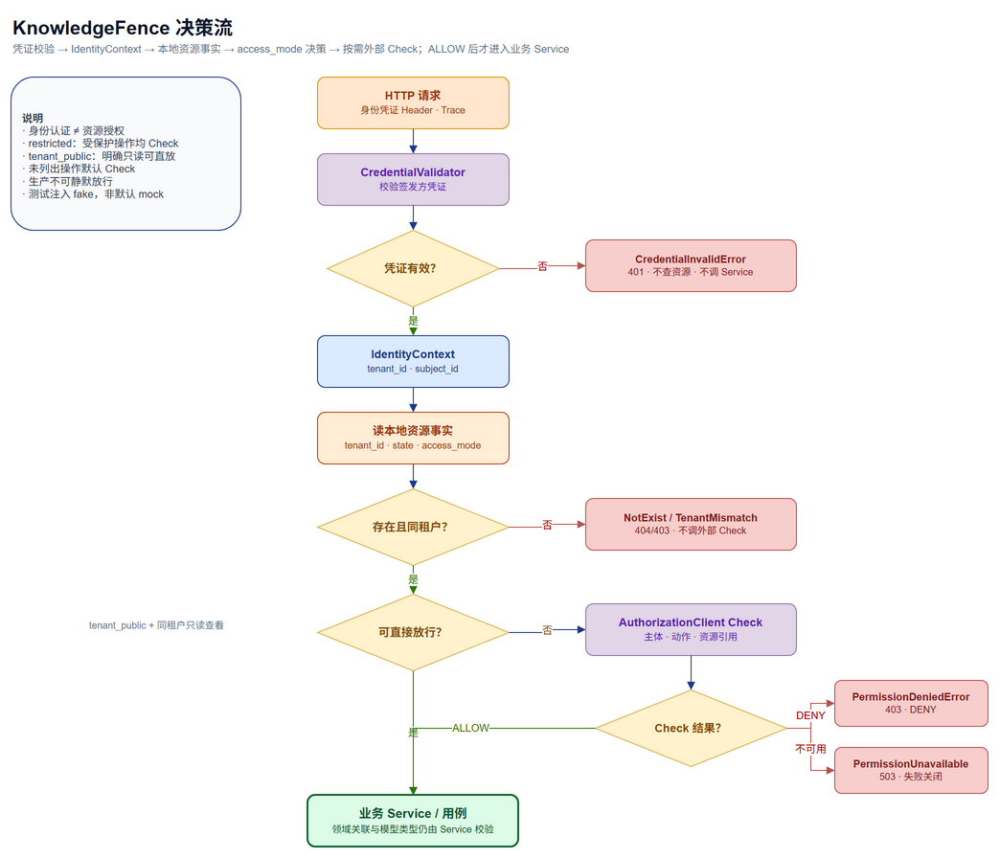

# 公共业务请求边界

本文描述知识库微服务业务接口共用的身份、权限、数据传递和错误处理约定，供后续业务模块设计与实现 review。本文是设计稿，不表示相关代码已经实现。整体分层与 ORM 传递原则见同目录的 `整体架构.md`；领域职责和接口方向见上级目录的 `架构设计.md`。

## 1. 目标与范围

公共请求边界负责回答以下问题：

- 请求如何取得可信的调用者和租户身份。
- 业务用例在什么位置校验资源归属和动作权限。
- API、业务服务、领域规则与 ORM 之间如何传递数据。
- 业务错误如何转换为一致的 HTTP 响应。

本设计遵循平台 README 的边界：租户与权限服务签发身份凭证并提供资源授权 Check；knowledge-backend 的 API Fence 校验凭证、读取本地资源事实，并在需要时调用授权 Check。本设计不定义权限服务的具体 Check 协议或 SDK，也不实现各领域的业务规则。凭证校验方式按身份凭证契约确认。

## 2. 请求处理流程



```text
HTTP 请求
  -> trace ID 中间件建立请求上下文
  -> API Fence 从请求头取得身份凭证并校验，得到可信 IdentityContext
  -> API 绑定并校验请求 DTO
  -> API Fence / KnowledgeFence 校验资源归属和动作权限
      -> 本地检查资源租户、状态和 access_mode
      -> access_mode 允许直接访问时放行
      -> 其他情况经 AuthorizationClient 调用租户与权限微服务 Check
  -> Fence 放行后 API 调用对应业务 Service / 用例
  -> Service 执行业务规则、数据访问和外部能力调用
  -> Service 返回业务结果
  -> API 转换为响应 DTO 和统一响应结构
  -> HTTP 响应
```

身份认证与资源授权是不同步骤：凭证携带签发方确认的身份信息；Fence 校验凭证有效性并取得可信身份上下文；授权 Check 判断调用者是否能对指定资源执行指定动作。身份凭证无效时不调用业务服务；授权拒绝或权限服务不可用时，用例不得继续产生业务副作用。

公开业务接口使用 `/api/v1` 前缀。健康检查等明确的运行状态接口可以不要求业务身份认证；其他接口按具体业务操作声明所需认证和权限动作。

## 3. 身份上下文

用户在调用 knowledge-backend 前，已从租户与权限服务获得身份凭证，并在请求头中携带。凭证包含身份信息，不包含某项资源动作是否允许。API Fence 校验凭证后，从可信凭证内容构造只读的 `IdentityContext`，供后续授权与业务逻辑使用。概念字段如下：

| 字段 | 用途 |
| --- | --- |
| `tenant_id` | 当前调用范围中的租户标识；资源租户隔离的可信来源 |
| `subject_id` | 发起调用的用户或服务主体标识，供权限检查和审计使用 |
| `credential_context` | 校验凭证时得到、调用外部权限服务可能需要的已验证上下文；不作为普通 API 字段返回 |

凭证在 HTTP 层的 Header 名称、格式、签名/校验方式和字段类型以平台身份契约为准。客户端传入的普通 JSON、query 参数或未校验的自定义身份头不能代替身份凭证；业务请求体、路径和普通 query 参数也不能覆盖凭证中的 `tenant_id` 或 `subject_id`。如 API 将来需要显式指定其他租户范围，必须由平台身份/权限契约定义授权方式，不能直接信任客户端传值。

`trace_id` 由现有 trace 中间件维护，属于请求关联信息，不是身份字段，也不能作为认证或授权依据。

## 4. KnowledgeFence 与资源授权

`KnowledgeFence` 是每个业务 API 进入真实业务逻辑前的公共围栏。按平台 README，它位于 API 边界：先校验请求头中的身份凭证，再读取本地资源事实，最后按需请求外部授权 Check。Fence 放行后 API 才调用业务 Service。Fence 不是权限微服务，也不持有授权 Grant。

KnowledgeFence 负责：

1. 从请求头取得租户与权限服务签发的身份凭证，校验凭证并解析可信身份字段。凭证无效或缺少必要身份时拒绝请求。
2. 根据凭证中的 `tenant` 和请求指定的资源 ID，从本服务读取该资源事实，包括资源所属 `tenant_id`、资源状态和 `access_mode`。
3. 资源不存在、租户不匹配或不满足请求所需的本地状态时拒绝请求，不调用授权 Check，也不进入业务逻辑。
4. 根据同租户关系、`access_mode` 和请求动作决定是否需要外部 Check。符合直接放行规则时进入业务逻辑；否则把经过校验的身份主体、动作和资源引用交给租户与权限服务 Check。
5. Check 返回 ALLOW 才放行；DENY 映射为 `PermissionDeniedError`；服务不可用或结果不确定映射为 `PermissionUnavailableError`。后两者都中止业务逻辑。

资源间的业务一致性由对应领域 Service 校验，而不是交给外部权限服务。例如，文件所属库、文件夹所属库、模型所属租户及模型类型是否符合绑定用途，仍由本服务检查。

### 4.1 动作与访问方式

动作名称以架构设计为准，当前明确的核心动作是：

| 操作 | 权限动作 |
| --- | --- |
| 上传文件 | `upload_file` |
| 检索知识库 | `use` |

其他创建、编辑、删除和管理操作，在对应领域 API 设计中补充明确动作名，不使用含义模糊的通用权限判断。

知识库的 `access_mode` 规则：

- `restricted`：所有受保护操作均向租户与权限服务 Check。
- `tenant_public`：同一租户内架构明确允许的只读查看操作可直接放行；上传、编辑和管理仍需 Check。
- `tenant_public` 不代表匿名访问，也不跳过凭证校验或资源租户归属校验。

具体哪些读取接口属于可直接放行的查看操作，应在对应 API 设计中列出；未明确列出的操作默认需要 Check。

### 4.2 外部权限客户端与 mock

KnowledgeFence 不直接耦合某个 HTTP SDK 或租户与权限微服务的具体 Check 接口。它依赖一个凭证校验边界和一个权限检查客户端边界（本文暂称 `CredentialValidator`、`AuthorizationClient`），由 infrastructure 提供真实实现。凭证校验可以是验证签发方凭证签名/声明，也可能包含平台规定的校验调用；具体方式按身份契约确认。Check 客户端的接口路径、认证方式、请求字段、响应格式、超时和错误码，须以后续确认的平台服务契约为准。

在权限微服务尚未实现时，KnowledgeFence 测试通过注入轻量 fake 即可推进：测试凭证验证器只接受测试中显式构造的身份凭证并返回固定身份；测试 `AuthorizationClient` 通过测试参数返回 ALLOW、DENY 或模拟不可用。测试替身实现与生产依赖相同的调用边界，不改变 Fence 逻辑。测试重点是凭证拒绝、本地租户/状态拦截、直接放行分支、外部 ALLOW/DENY/不可用分支，以及 Fence 拒绝时 Service 未被调用。

初期默认不需要独立 mock server：单元和应用集成测试注入 fake，覆盖 Fence 行为即可。如果之后需要手动验证真实 HTTP 客户端的序列化、超时和错误处理，再按已确认的服务契约启动独立 mock server。mock server 属于本地开发/集成测试工具，不在 knowledge-backend 的公开路由中添加伪造的权限 API。

真实环境默认失败关闭：真实凭证校验能力未配置/无法校验，或外部 Check 服务不可用时，依赖它的请求不得静默放行。fake/mock 只能通过测试注入或明确的本地开发配置启用，不能成为生产环境的默认实现。

### 4.3 KnowledgeFence 调用链

一次受保护的 HTTP 用例按以下顺序执行：

1. Trace 中间件读取合法的 `X-Trace-ID` 或生成 ID，并建立请求日志上下文。
2. 客户端在请求头中携带租户与权限服务签发的身份凭证。API Fence 读取并校验该凭证；失败时返回认证错误，不查询资源，也不调用业务 Service。
3. Fence 从校验结果得到 `user`、`tenant`、`subject` 等可信身份上下文；请求体或 query 中自行提供的租户号不参与隔离。
4. Fence 根据请求路径/参数确定目标资源和操作，从本地数据库读取对应知识库等资源事实，至少核对存在性、资源 `tenant_id`、`access_mode` 和该动作要求的本地状态。
5. 若资源与凭证租户不一致，或本地资源状态不满足要求，Fence 直接拒绝。不同租户资源不交给外部 Check 来代替本服务的租户隔离判断。
6. 若资源属于凭证租户，Fence 根据 `access_mode` 与动作决定 Check：架构明确允许的同租户宽松访问直接放行；其余请求通过 `AuthorizationClient` 提交主体、动作、资源类型/引用及平台契约要求的身份上下文。
7. 外部返回 ALLOW 后 Fence 才将请求交给业务 Service；DENY 或服务不可用时返回结构化错误，Service 不执行。
8. Service 执行业务规则和数据操作，返回结果；API 组装响应，响应头与响应体 trace ID 一致。

调用关系概览：

```text
HTTP Request (identity credential header)
  -> API Fence / KnowledgeFence
      -> CredentialValidator -> trusted IdentityContext
      -> Resource Repository/DAO -> MySQL resource facts
      -> local tenant/access_mode decision
      -> AuthorizationClient -> Tenant & Permission Service Check (when required)
  -> Business Service / Use Case (only after ALLOW)
      -> Domain rules
      -> Repository/DAO and other infrastructure
  -> API response mapping
```

因此，KnowledgeFence 既不是租户与权限微服务本身，也不负责所有业务校验。它作为 API 业务入口前的公共围栏，校验外部签发的身份凭证，读取本地资源归属与访问方式，并按规则决定直接放行或请求外部授权 Check；跨资源关系和模型类型等领域约束仍由具体业务 Service 负责。

## 5. API、Service 与 ORM 的数据边界

### API 层

- 解析 HTTP 参数、文件输入和请求 DTO，并执行协议层校验。
- 通过 API Fence 取得已校验的身份上下文及授权结果；只有放行后才调用相应业务 Service。
- 不直接创建 Session、执行 ORM 查询或把 ORM 对象返回给调用方。
- 将 Service 返回的结果投影为响应 DTO，并负责 HTTP 状态码和统一响应包装。

### Service / 用例层

- 接收明确的业务参数和可信租户/主体上下文，不接收 FastAPI `Request`、`UploadFile` 等框架对象。
- 假设 API Fence 已完成请求级身份及权限校验；仍执行本服务领域规则和资源关联校验。
- 通过数据访问实现读写 ORM，协调对象存储、Celery、模型客户端、ES 和 Milvus 等能力。
- 定义数据库事务边界；一个用例跨越数据库和外部系统时，明确各步骤状态、幂等条件和重试方式，不假设跨系统原子事务。
- 返回业务结果或视图所需数据，不构造 HTTP 异常。

### ORM 与数据访问

- ORM 是 SQLModel/SQLAlchemy 持久化映射，表达数据库字段和约束，不作为 API 请求/响应模型。
- 按领域组织的数据访问实现（Repository/DAO）负责 Session 上的查询与持久化，并向 Service 提供 ORM 记录。
- 现阶段可以由 Service 直接使用 ORM 记录承载业务用例数据，不为每张表复制一套字段相同的领域对象；如具体领域规则表明需要独立领域实体，再单独论证。
- ORM、Session 和延迟加载关系不越过 Service 层，不进入 HTTP 响应或 Celery 消息。

API DTO、业务参数和 ORM 之间按用途转换：

```text
Request DTO -> Service 参数 + IdentityContext -> Repository/DAO -> ORM
ORM / 外部能力结果 -> Service 业务结果 -> Response DTO -> HTTP 响应
```

涉及敏感字段（例如 Provider 凭据）的 ORM 记录不能直接映射为公开响应；Service 或响应组装逻辑必须明确排除或脱敏。

## 6. 错误与响应约定

业务和领域代码表达可识别的知识库错误，不依赖 FastAPI。API 边界统一把错误映射为 HTTP 响应。当前架构设计已经定义的公共错误至少包括：

| 错误 | 含义 | 建议 HTTP 状态 |
| --- | --- | --- |
| `CredentialInvalidError` | 凭证缺失、过期或无效 | 401 |
| `TenantMissingError` | 已认证上下文缺少租户 | 403 或按平台身份契约处理 |
| `PermissionDeniedError` | 权限 Check 拒绝 | 403 |
| `PermissionUnavailableError` | 权限服务不可用或无法完成 Check | 503 |
| `KnowledgeNotExistError` | 资源不存在或不可访问 | 404；避免泄露跨租户资源存在性 |
| `KnowledgeTenantMismatchError` | 资源不属于当前租户 | 按是否需隐藏资源存在性映射为 404 或 403 |

成功响应沿用架构设计中的 `ApiResponse[T]`：`code`、`message`、`data`、`trace_id`。失败响应是否使用完全相同的包装、业务错误 `code` 与 HTTP 状态的对应规则，以及资源租户不匹配时的隐藏策略，需要结合现有 Bisheng/API 契约确认后统一确定。本表中的状态码是讨论建议，不视为最终接口约定。

响应中的 `trace_id` 应与响应头 `X-Trace-ID` 一致。错误日志可以记录错误类别、资源标识和 trace ID，不记录凭证、密钥或文件正文。

## 7. Celery 等非 HTTP 入口

Celery Worker 不携带 HTTP Request 或 ORM 实例。任务消息传递完成用例所需的资源标识、`tenant_id`、必要参数及 `trace_id`；Worker 根据 ID 重新读取 ORM 并检查库、文件、模型等资源间的租户和状态关系。

外部用户权限 Check 通常在任务创建请求阶段完成；任务执行阶段使用受控的服务身份和任务租户上下文，不伪造原始用户凭证。任务是否需要再次通过 `AuthorizationClient` 向权限服务 Check，应由平台服务身份契约和具体任务授权模型决定，在实现 Celery 业务任务前确认。任何情况下，Worker 都不能仅凭消息中的 `tenant_id` 信任资源关系，必须重新读取并校验本服务资源事实。

## 8. 待确认事项

以下内容需在对应实现开始前对照 Bisheng 和平台接口确认：

1. 请求头中的身份凭证名称、格式和校验方式，以及 `IdentityContext` 的实际字段。
2. 外部租户与权限服务 Check 的请求协议、`AuthorizationClient` 的具体方法、超时和错误分类。
3. 每类只读接口在 `tenant_public` 下是否允许同租户直接访问。
4. `ApiResponse` 是否同时包装错误响应，以及业务错误码与 HTTP 状态码的完整映射。
5. 跨租户资源不匹配时返回 403 还是统一隐藏为 404。
6. Celery Worker 使用何种服务身份，以及哪些任务需要执行外部权限 Check。
7. 是否需要手动 HTTP 联调 mock server；当前建议自动化测试先使用注入的 fake/mock，只有需要验证真实客户端 HTTP 协议时再增加独立 mock server。

这些事项不阻碍先实现明确的认证上下文、错误类型和单个业务用例；但涉及平台契约或影响外部 API 行为的取舍应在相应模块编码前确认。
