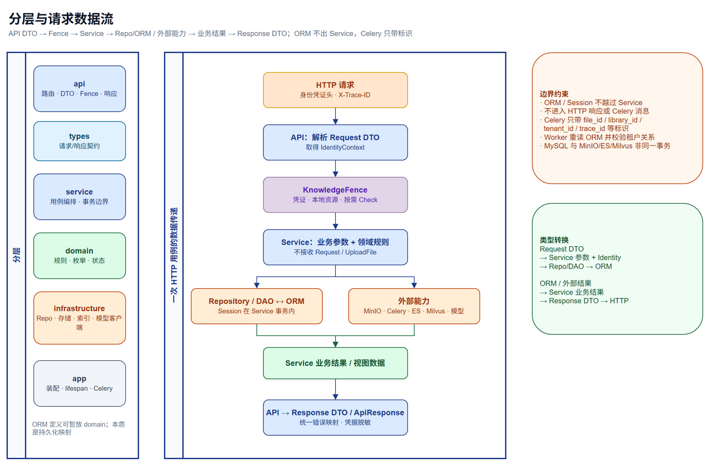

# 知识库业务层整体架构

本文用于对齐重构版知识库服务中 API、业务服务、领域规则、ORM 与基础设施之间的职责和数据传递方式。它是讨论中的设计说明，不代表相关业务代码已经实现。整体领域范围以上级目录的 `架构设计.md` 为准。

## 1. 分层职责



| 层 | 负责内容 | 不负责内容 |
| --- | --- | --- |
| `api` | HTTP 路由、参数绑定、请求校验、认证与请求上下文依赖、响应状态和响应结构转换 | 领域规则、直接操作 Session 或 ORM、调用 MinIO/ES/Milvus |
| `types` | API 请求/响应模型、跨层命令与结果类型、分页结构、错误响应契约 | SQL 表映射、数据库查询、业务流程编排 |
| `service` | 一个业务用例的执行流程；协调领域规则、数据访问和外部能力；确定事务边界 | HTTP 细节、SQL 查询细节、基础设施客户端配置 |
| `domain` | 领域概念、枚举、状态约束和不依赖 I/O 的业务规则 | HTTP、Session、外部客户端和运行时装配 |
| `infrastructure` | ORM/数据库访问、Session、MinIO、Redis、解析模型、Embedding、Rerank、ES、Milvus 的技术实现 | 决定用户是否有权操作资源、定义 API 契约 |
| `app` | FastAPI/Celery 组装、依赖注入、资源生命周期和任务入口 | 承载具体业务规则 |

API 的认证依赖负责得到经过校验的身份上下文；请求入口在调用受保护的业务用例前通过 `KnowledgeFence` 完成资源归属与权限检查。业务服务仍负责校验本服务内的领域约束，例如关联模型、库、文件是否属于同一租户。租户 ID 来自可信身份上下文，不从请求体中接受或覆盖。拒绝或权限服务不可用时，用例不继续执行。

## 2. ORM 与业务服务之间的关系

当前 ORM 使用 SQLModel 定义在各领域目录中，例如 Provider/Model ORM 位于 `domain/model_config`，知识库和文档 ORM 位于 `domain/catalog`，文件 ORM 位于 `domain/ingest`。这些类是数据库表映射，包含 SQLAlchemy/SQLModel 持久化细节；它们与 API 请求/响应类型不是同一类契约。

建议业务服务通过 infrastructure 中按领域组织的数据访问实现（Repository/DAO）读写 ORM。Repository/DAO 持有或接收 Session，执行查询、增加、更新和删除，并把 ORM 记录返回给调用它的业务服务。业务服务在事务范围内组合这些记录、应用领域规则并调用其他能力。当前阶段可以直接让业务服务处理这些 ORM 记录，不额外复制一套字段相同的持久化对象和领域对象；但 ORM 不应越过业务服务直接返回给 API，也不应放入 Celery 消息。

这样的边界保留了 Bisheng 中 DAO 返回 SQLModel 记录、领域服务组合业务行为、Schema 单独构造接口结果的既有做法，同时让 HTTP 契约与数据库结构解耦。具体是否需要在某个复杂聚合中引入独立领域实体，按实际规则和重复映射成本再决定，不预先为所有表增加映射层。

## 3. HTTP 请求与响应的数据流

```text
HTTP 请求
  -> 中间件建立 trace 上下文
  -> API 解析请求 DTO 并取得身份上下文
  -> KnowledgeFence 校验资源归属与动作权限
  -> API 调用对应业务 Service
  -> Service 调用 Repository/DAO 读取或修改 ORM
  -> Service 执行业务规则并协调基础设施
  -> Service 返回业务结果或视图数据
  -> API 转为响应 DTO / ApiResponse
  -> HTTP 响应
```

- API DTO 负责协议校验和字段约束，不应直接作为 ORM 对象写入 Session。
- Service 接收明确的业务参数和可信身份上下文，不接收 FastAPI `Request`、`UploadFile` 等 HTTP 对象；上传内容应由 API 交给服务可用的文件流/字节抽象，具体形式在文件上传实现阶段结合 Bisheng 确定。
- Service 返回业务结果或响应视图所需数据，API 负责组装统一响应包装和 HTTP 状态码。
- ORM 字段、数据库默认值、关系加载方式和 Session 状态不暴露给 API。敏感配置如 Provider API Key 需在返回视图前过滤或脱敏。
- 领域错误由 API 边界统一转换为约定的错误响应；业务服务不构造 HTTP 异常。

## 4. 典型业务用例的数据传递

### 4.1 模型配置

创建 Provider/Model 时，API 将请求 DTO 交给 `ModelService`。服务从身份上下文取 `tenant_id`，校验名称、供应商与模型关系及模型类型，再通过数据访问实现写入 `model_provider`、`model` ORM。查询模型供其他领域调用时，服务根据模型 ID 读取模型和供应商 ORM，校验租户、类型和启用状态，整理出必要的 endpoint、凭据及模型参数交给对应客户端；凭据不进入公开响应。

`ModelStatus` 是业务代码使用的整数枚举：`NORMAL = 0`、`ERROR = 1`、`UNKNOWN = 2`，数据库列保存对应整数。`online` 是另外一个布尔字段，不能拿它替代状态枚举。API 对 `status` 返回整数还是枚举名称，应在接口契约阶段明确；如需兼容 Bisheng 行为，建议返回整数值。

### 4.2 文档库与目录

创建知识库时，API DTO 传入库名、访问方式和模型 ID。`LibraryService` 读取模型 ORM 并验证其租户、模型类型和启用状态，生成索引逻辑名，再写入 `knowledge_library`。后续文件夹操作由目录服务检查父节点属于同一库后写入 `knowledge_folder`。

目录服务返回的库、文件夹和文档结果由 API 投影为 `LibraryView`、`FolderView`、`DocumentView`。目录 API 不读取对象存储，也不直接操作 ES/Milvus。

### 4.3 文件上传与异步入库

上传 API 先完成库资源权限检查，再把文件内容和元数据交给入库服务。入库服务负责协调 MinIO 对象写入、`knowledge_file` ORM 记录创建以及后续 Celery 任务提交。对象存储与 MySQL 不共享事务；上传阶段需要明确失败后的可重试方式及可能的孤儿对象清理策略，细节在实现文件上传阶段依据 Bisheng 现有约定确定。

Celery 消息只携带 `file_id`、`library_id`、`tenant_id`、必要的处理参数和 `trace_id` 等标识，不携带 ORM 实例、Session、上传文件对象或密钥。Worker 入口从 app 装配业务服务；服务重新读取 ORM 记录，按库绑定的模型配置执行解析、切分、Embedding 和索引写入，并更新文件状态。Celery 是异步执行机制，不另建 `ingest_task` 表。

入库成功时，业务流程创建或更新逻辑文档与版本，并通过 `knowledge_document.primary_version_id` 更新唯一的主版本指针。版本表不另存 `is_primary`。

### 4.4 检索

检索 API 将查询和库 ID 列表交给检索服务，并在调用前完成 `use` 权限检查。检索服务读取库、模型绑定及文档状态等必要 ORM 数据，解析每个库绑定的 Embedding 配置后访问 Milvus 和 ES；候选合并、Rerank 和引用还原完成后返回结果视图。切片正文和向量由索引系统保存，不为它们增加关系型 ORM 表。

## 5. 事务与错误边界

单个业务用例的数据库读写由服务确定事务范围，数据访问实现执行 ORM 操作；Session 成功提交由调用方显式控制，失败或取消时回滚。一个用例涉及 MySQL 与 MinIO、Celery、ES 或 Milvus 时，不把它们描述成同一个数据库事务，而是为每一步定义状态、幂等条件和重试入口。

领域与业务服务抛出知识库领域错误；API 层映射为统一错误码、消息和 HTTP 状态。基础设施连接或模型端点异常应转换为可识别的业务错误或基础设施错误，日志包含 trace ID，但不记录密钥和文件正文。

## 6. 需要在具体模块开始前确认的细节

- `model.status` 的数据库值已按 Bisheng 对齐为 `0` 正常、`1` 异常、`2` 未知；接口是否返回整数需在模型配置 API 阶段确定。
- `online` 表示启用开关还是既有 Bisheng 中更具体的在线语义，应结合模型管理代码确认；它与探测结果 `status` 分开存储。
- 当前 ORM 类位于 `domain` 目录，但本质是持久化映射。首批 Repository/DAO 落地时再确定是否移动 ORM 定义；避免为了目录纯度先做无行为收益的搬迁。
- 跨 MySQL、MinIO、Celery、ES、Milvus 的失败恢复，随上传与入库垂直链路逐项确定，不引入通用工作流或额外任务表。
