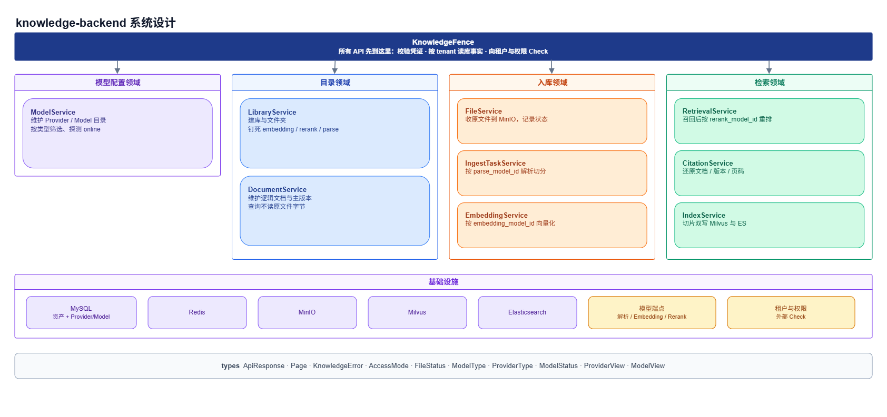
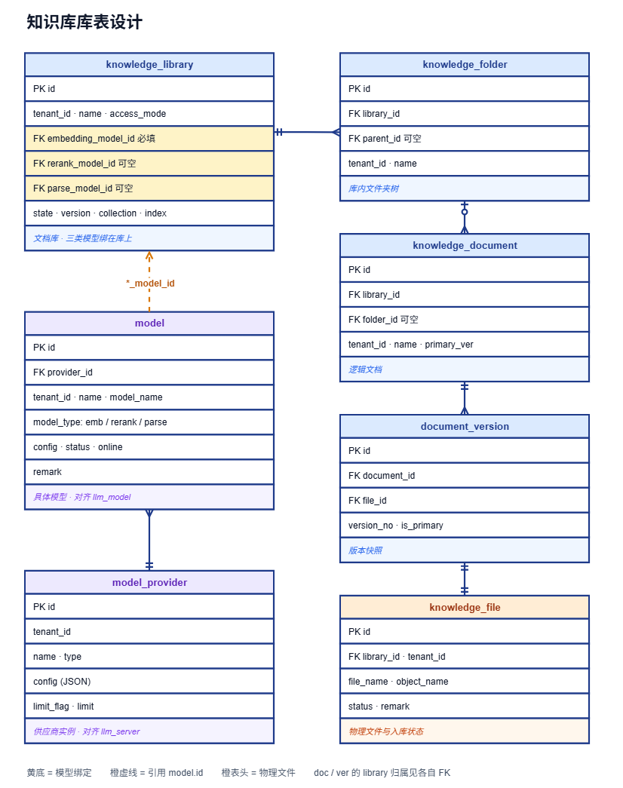
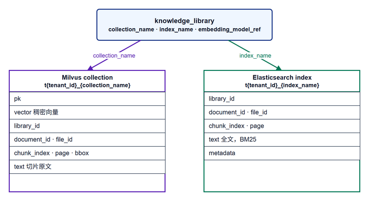

# 知识库微服务架构设计

本文按平台 README 设计 `knowledge-backend`。本服务只做文档库的管理、入库和检索，不做知识空间、不做 QA 库、也不生成回答。

资源事实（库是否存在、租户、版本、状态、访问方式）存在本服务。谁有什么权限存在租户与权限服务。Agent、工作流只保存资源引用和版本，通过本服务的检索接口拿片段。

本阶段模型目录先放在知识库服务内，只覆盖入库与检索用到的三类：`embedding`、`rerank`、`document_parse`。Agent 侧的对话 LLM 不在此维护；后续若上收为平台模型服务，知识库只保留库上的三个 `*_model_id` 引用即可。

## 1. 系统设计



### 1.1 领域与服务

所有接口前缀为 `/api/v1`。身份凭证和 `trace_id` 放在请求头里。写操作和 `POST /retrieve` 先过 `KnowledgeFence`：校验凭证，按凭证中的 `tenant` 读库事实，再向租户与权限 Check。

库上的 `access_mode`：

- `restricted`：所有动作都要 Check。
- `tenant_public`：同一租户的查看可直接放行；上传、编辑、管理仍要 Check。

入库动作是 `upload_file`，检索动作是 `use`。DENY 或权限服务不可用时返回错误，领域服务不执行。

#### 模型配置领域

模型配置领域负责「本服务能调用哪些外部能力」。它维护供应商实例和具体模型目录，不执行入库、不做检索。入库与检索领域只拿库上绑定的 `model_id`，经本领域解析出 endpoint / key / model_name 后再调用。

**`ModelService` — 供应商与模型目录**

- **负责**：登记 `model_provider`（对齐原 Bisheng 的 `llm_server`：`type` + `config`）；在供应商下登记 `model`（对齐 `llm_model`）；按类型筛选、探测 online/status。本阶段 `model_type` 仅三种：`embedding`、`rerank`、`document_parse`。
- **逻辑关系**：目录与库绑定分离——`ModelService` 只管「有哪些可用模型」；`LibraryService` 才决定「某个库用哪几个」。`IngestTaskService` / `EmbeddingService` / `RetrievalService` 不写这两张表，只按 id 解析后调用。
- **输入 / 输出**：创建供应商返回 `ProviderView`；创建模型返回 `ModelView`。列表可按 `model_type` 过滤，供建库时选型。

| 方法 | 路径 | 参数 | 响应 `data` |
| --- | --- | --- | --- |
| POST | `/providers` | body：`name`，`type`，`config` | `ProviderView`：`id`，`name`，`type` |
| GET | `/providers` | query：`cursor`，`limit` | `Page[ProviderView]` |
| POST | `/providers/{provider_id}/models` | path：`provider_id`；body：`name`，`model_name`，`model_type`，`config` 可选 | `ModelView`：`id`，`provider_id`，`name`，`model_type`，`status`，`online` |
| GET | `/models` | query：`model_type` 可选，`cursor`，`limit` | `Page[ModelView]` |

#### 目录领域

目录领域负责「用户能看见、能组织的知识容器与文档元数据」。它不碰原文件字节，也不写向量。外部调用方先在这里建库、建文件夹、认文档；后续入库和检索都挂在这些目录对象上。创建库时把三类模型 id 钉在库上。

**`LibraryService` — 文档库容器**

- **负责**：创建一个可检索的文档库；维护库名、访问方式、库状态；**绑定**本库默认的 Embedding / Rerank / 文档解析模型；在库下建文件夹树。库是本服务的聚合根。
- **逻辑关系**：创建库时校验三个 `*_model_id` 存在、属于当前租户、且 `model_type` 分别匹配；写入 `knowledge_library`，并生成该库的 Milvus / ES 逻辑名。`embedding_model_id` 必填（换模型通常要重建索引）；`rerank_model_id`、`parse_model_id` 可空（空则运行时用租户默认或跳过对应步骤，由实现约定）。建文件夹只改 `knowledge_folder`。
- **输入 / 输出**：入参含库名、`access_mode` 和模型 id；返回 `LibraryView`（含三个绑定 id、`version`、`state`）。

| 方法 | 路径 | 参数 | 响应 `data` |
| --- | --- | --- | --- |
| POST | `/libraries` | body：`name`，`access_mode`，`embedding_model_id`，`rerank_model_id` 可选，`parse_model_id` 可选 | `LibraryView`：`id`，`name`，`access_mode`，三个 `*_model_id`，`version`，`state` |
| GET | `/libraries` | query：`cursor`，`limit` | `Page[LibraryView]` |
| POST | `/libraries/{library_id}/folders` | path：`library_id`；body：`name`，`parent_id` 可空 | `FolderView`：`id`，`library_id`，`parent_id`，`name` |

**`DocumentService` — 逻辑文档与主版本**

- **负责**：把「用户眼里的一篇文档」和「某次实际上传产生的物理文件」分开。逻辑文档长期存在；每次重新上传或重建会生成新版本，对外默认只认主版本。
- **逻辑关系**：入库成功后由入库链路创建或更新 `knowledge_document`，并指向当前 `primary_version_id`。查询文档时读目录表，不读 MinIO。
- **输入 / 输出**：按 `document_id` 返回 `DocumentView`（`id`、`name`、`version`、`primary_version_id`、`file_id`）。

| 方法 | 路径 | 参数 | 响应 `data` |
| --- | --- | --- | --- |
| GET | `/documents/{document_id}` | path：`document_id` | `DocumentView`：`id`，`name`，`version`，`primary_version_id`，`file_id` |

#### 入库领域

入库领域负责「把原文件变成可检索切片」：收文件 → 排队处理 → 按库绑定的解析模型解析切分 → 按库绑定的 Embedding 模型向量化 → 写索引。它依赖目录领域已有的库与模型绑定；不维护供应商目录。

**`FileService` — 原文件入口**

- **负责**：接收 multipart 上传，把字节写入 MinIO，在 `knowledge_file` 记一条物理文件记录，初始状态为「等待」。上传前围栏检查 `upload_file`。
- **逻辑关系**：上传只落原文件和元数据，不立刻切分。调用方再显式触发 `process`。查状态走本服务。
- **输入 / 输出**：返回 `FileView`（`id`、`file_name`、`status`）；失败查询带 `remark`。

| 方法 | 路径 | 参数 | 响应 `data` |
| --- | --- | --- | --- |
| POST | `/libraries/{library_id}/files` | path：`library_id`；`multipart` 字段 `file` | `FileView`：`id`，`file_name`，`status`（初始为等待） |
| GET | `/files/{file_id}` | path：`file_id` | `FileView`：`id`，`file_name`，`status`，失败时带 `remark` |

**`IngestTaskService` — 解析与切分编排**

- **负责**：把已上传文件交给 Worker：状态改为「处理中」；按库上的 `parse_model_id` 解析出 Provider 配置，调用文档解析能力；再按 `split_rule`（可空）切成文本块。任务始终带 `tenant_id`。
- **逻辑关系**：入库流水线调度点。解析模型来自库绑定（经 `ModelService` 解析），不是写死的单一引擎 URL。切分完成后交给 `EmbeddingService` 与 `IndexService`；失败则写 `status`/`remark`。
- **输入 / 输出**：触发后立即返回「处理中」的 `FileView`；完成靠异步，调用方轮询 `FileService`。

| 方法 | 路径 | 参数 | 响应 `data` |
| --- | --- | --- | --- |
| POST | `/files/{file_id}/process` | path：`file_id`；body：`split_rule` 可选 | `FileView`，`status` 变为处理中 |

**`EmbeddingService` — 向量化（无独立路由）**

- **负责**：读库上的 `embedding_model_id`，解析 Provider 与 `model_name`，把每个切片编成稠密向量。本次任务可临时指定别的 embedding 模型（仍须同租户、同类型）。
- **逻辑关系**：只在入库任务内部调用。输出交给 `IndexService` 写 Milvus。模型缺失、类型不符或 offline 时抛 `KnowledgeNoEmbeddingError`。

#### 检索领域

检索领域负责「按问题从已入库内容中拿片段」。它不改目录、不写原文件；Rerank 使用库上绑定的 rerank 模型。

**`RetrievalService` — 混合召回**

- **负责**：`use` 放行后，对指定库做稠密召回（Milvus）+ 关键词召回（ES），合并后按库的 `rerank_model_id` 做 Rerank，截取 `top_k`。请求体可带临时 `rerank_model_id` 覆盖（同租户、类型须为 `rerank`）。
- **逻辑关系**：只检索主版本且文件状态成功的切片。多库检索时若库绑定不同 rerank，实现上取请求覆盖或第一个库的绑定（文档约定一种，避免静默混用）。
- **输入 / 输出**：返回 `RetrievalView`，`items[]` 含出处与 `score`。

| 方法 | 路径 | 参数 | 响应 `data` |
| --- | --- | --- | --- |
| POST | `/retrieve` | body：`library_ids`，`query`，`top_k`，`rerank_model_id` 可选 | `RetrievalView`：`items[]`，每项含 `document_id`，`version`，`file_id`，`page`，`text`，`score` |

**`CitationService` — 引用还原（无独立路由）**

- **负责**：把命中切片还原成文档、版本、页码、可选 bbox，供下游对回原文件。

**`IndexService` — 双写索引（无独立路由）**

- **负责**：切分与向量化之后，用同一 `chunk_index` 写入该库的 Milvus collection 和 ES index；重建时同样双写，避免一侧有一侧无。

### 1.2 基础设施

| 组件 | 谁用 | 存什么 |
| --- | --- | --- |
| MySQL | 四个领域的服务 | 第 2 节的关系表（含 Provider/Model），独立库和账号 |
| Redis | `IngestTaskService`、预览 | 本服务自己的键前缀 |
| MinIO | `FileService` | 原文件、预览文件，本服务单独 Bucket |
| Milvus | `IndexService`、`RetrievalService` | 稠密向量，见第 3 节 |
| Elasticsearch | `IndexService`、`RetrievalService` | 切片全文，见第 3 节 |
| 解析 / Embedding / Rerank 端点 | 入库与检索经 `ModelService` 解析后调用 | 配置在 `model_provider.config`，不写死在代码 |
| 租户与权限 | `KnowledgeFence` | 外部 Check；本服务不保存 Grant |

### 1.3 types

```python
class ApiResponse(BaseModel, Generic[T]):
    code: int = 0
    message: str = "ok"
    data: T | None = None
    trace_id: str


class Page(BaseModel, Generic[T]):
    items: list[T]
    next_cursor: str | None = None
```

视图类型：`ProviderView`、`ModelView`、`LibraryView`、`FolderView`、`DocumentView`、`FileView`、`RetrievalView`。

枚举：

- `AccessMode`：`restricted` / `tenant_public`
- `LibraryState`、`FileStatus`（等待、处理中、成功、失败、重建中、超时）
- `ModelType`：`embedding` / `rerank` / `document_parse`
- `ProviderType`：复用原 Bisheng `LLMServerType`（openai、azure_openai、ollama、xinference、vllm、qwen、…）；`document_parse` 类供应商用同类扩展（如 mineru、自定义 HTTP）
- `ModelStatus`：正常 / 异常 / 未知

异常继承 `KnowledgeError`：

| 类型 | code | 何时抛出 |
| --- | --- | --- |
| `CredentialInvalidError` | 10980 | 凭证缺失、过期或签名无效 |
| `TenantMissingError` | 10981 | 凭证里没有租户 |
| `PermissionDeniedError` | 10982 | Check 返回 DENY |
| `PermissionUnavailableError` | 10983 | 租户与权限不可用 |
| `KnowledgeExistError` | 10900 | 同一租户下名称重复 |
| `KnowledgeNotExistError` | 10931 | 库、文档或模型不存在，或已归档 |
| `KnowledgeTenantMismatchError` | 10933 | 资源 `tenant_id` 与凭证不一致 |
| `KnowledgeNoEmbeddingError` | 10901 | 库没有可用的 Embedding 模型 |
| `KnowledgeModelTypeMismatchError` | 10902 | 绑定的 model_type 与用途不符 |
| `KnowledgeFileEmptyError` | 10911 | 上传内容为空 |
| `KnowledgeFileNotSupportedError` | 10914 | 文件类型不支持 |
| `KnowledgeFileDamagedError` | 10913 | 文件损坏，无法解析 |
| `KnowledgeEtl4lmTimeoutError` | 10915 | 解析引擎超时 |
| `KnowledgeFileChunkMaxError` | 10912 | 切片超出长度上限 |
| `KnowledgeRebuildingError` | 10921 | 库正在重建索引 |
| `KnowledgeFileNotExistError` | 10932 | 物理文件不存在 |

## 2. 库表设计

表分两块：一块是知识资产事实（库、文件夹、文档、版本、文件）；一块是本服务用到的模型目录（供应商、模型）。不存谁被授权——那在租户与权限服务。



### 2.1 模型目录

**`model_provider` — 供应商实例**

对齐原 Bisheng 的 `llm_server`。一行 = 租户下配置好的一个供应商接入点（含 key、endpoint 等），不是抽象枚举本身。

| 关键字段 | 含义 |
| --- | --- |
| `id` | 主键 |
| `tenant_id` | 所属租户；目录按租户隔离 |
| `name` | 显示名；同一租户下唯一 |
| `type` | 供应商类型，取值同原 `LLMServerType`（及解析类扩展） |
| `config` | JSON：API Key、base URL、超时等公共连接配置 |
| `limit_flag` / `limit` | 可选日调用限额 |

**`model` — 具体模型**

对齐原 Bisheng 的 `llm_model`。一行 = 某个供应商下的一个可调用模型。

| 关键字段 | 含义 |
| --- | --- |
| `id` | 主键；库表三个 `*_model_id` 引用它 |
| `provider_id` | 所属供应商 |
| `tenant_id` | 冗余租户，便于按租户列模型 |
| `name` | 显示名 |
| `model_name` | 调用时传给供应商的真实模型名 |
| `model_type` | `embedding` / `rerank` / `document_parse` |
| `config` | JSON：模型级覆盖（维度、批大小、解析参数等） |
| `status` / `online` | 探测结果与是否上线；offline 的不能新绑定 |
| `remark` | 异常原因 |

### 2.2 知识资产

**`knowledge_library` — 文档库**

存一个可检索知识容器的元数据。一行 = 一个库。模型绑定落在这一行，不落在任务表。

| 关键字段 | 含义 |
| --- | --- |
| `id` | 库主键，对外 API 与授权资源引用都用它 |
| `tenant_id` | 所属租户；围栏隔离只认这个字段 |
| `name` | 库显示名；同一租户下不可重复 |
| `access_mode` | `restricted` 或 `tenant_public` |
| `state` / `version` | 生命周期与乐观版本 |
| `embedding_model_id` | 必填；入库向量化与 query 向量化读它；更换通常触发重建 |
| `rerank_model_id` | 可空；检索 Rerank 默认模型 |
| `parse_model_id` | 可空；入库文档解析默认模型 |
| `collection_name` / `index_name` | Milvus / ES 逻辑名；物理名加 `t{tenant_id}_` 前缀 |

**`knowledge_folder` — 库内文件夹**

存库内树状分组。一行 = 一个文件夹节点。不参与检索打分。

| 关键字段 | 含义 |
| --- | --- |
| `library_id` | 所属库；不能跨库 |
| `parent_id` | 父文件夹；空表示库根下 |
| `tenant_id` | 冗余租户 |
| `name` | 文件夹名 |

**`knowledge_document` — 逻辑文档**

存用户感知的「一篇文档」。多次上传形成多版本，对外默认只暴露主版本。

| 关键字段 | 含义 |
| --- | --- |
| `library_id` / `folder_id` | 落在哪个库、哪个文件夹 |
| `tenant_id` | 所属租户 |
| `name` | 文档显示名 |
| `primary_version_id` | 当前主版本；检索指向它 |

**`document_version` — 文档版本**

存某次入库形成的版本快照。旧版本可保留追溯，不默认参与检索。

| 关键字段 | 含义 |
| --- | --- |
| `document_id` | 所属逻辑文档 |
| `file_id` | 该版本对应的物理文件 |
| `version_no` | 与 `document_id` 唯一 |
| `is_primary` | 是否主版本 |

**`knowledge_file` — 物理文件与处理状态**

存一次上传在对象存储中的实体及入库进度。

| 关键字段 | 含义 |
| --- | --- |
| `library_id` / `tenant_id` | 文件归属 |
| `file_name` | 原始文件名 |
| `object_name` | MinIO 对象键 |
| `status` | 等待 / 处理中 / 成功 / 失败 / 重建中 / 超时；检索只认成功 |
| `remark` | 失败原因 |

## 3. 向量库

设计意图：检索既要「语义相近」，也要「关键词精确」。每个文档库对应一套 Milvus + 一套 ES；入库对同一切片双写，检索两边召回后再用库绑定的 Rerank 模型融合排序。向量维度由该库的 Embedding 模型决定，因此换 Embedding 必须重建，不能只改 `embedding_model_id` 而不重跑索引。



**为什么按库拆 collection / index**

- 按库删除、重建、限流更简单；也避免多租户挤在同一物理集合里只靠 filter 硬隔。
- 物理名：`t{tenant_id}_{collection_name}`、`t{tenant_id}_{index_name}`。
- 库表存逻辑名；读写时再拼租户前缀。

**Milvus — 稠密语义召回**

- **存什么**：每个切片一条：向量 + 定位信息 + 原文。
- **怎么用**：用库的 Embedding 模型把 `query` 编成同维向量后相似度检索。
- **关键字段**：`vector`（召回主字段）；`library_id` / `document_id` / `file_id` / `chunk_index`（与 ES 对齐的复合键）；`page` / `bbox`（引用高亮）；`text`（命中直接带回）。

**Elasticsearch — 稀疏关键词召回**

- **存什么**：同批切片的全文与可过滤元数据。
- **怎么用**：BM25 等词法检索，补专有名词与编号。
- **关键字段**：`text`；同一套复合键；`page`；`metadata`。

**双写与检索逻辑**

1. 入库：按 `parse_model_id` 解析 → 切分 → 按 `embedding_model_id` 向量化 → `IndexService` 双写。
2. 检索：Milvus + ES 各取候选 → 去重 → 按 `rerank_model_id`（或请求覆盖）Rerank → `top_k` → `CitationService` 补引用。
3. 删除或重建：两侧按库（或文件）清干净再按主版本重跑，避免单边残留。
