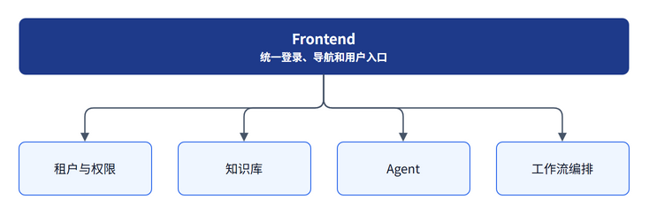
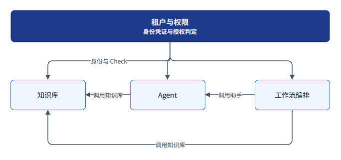
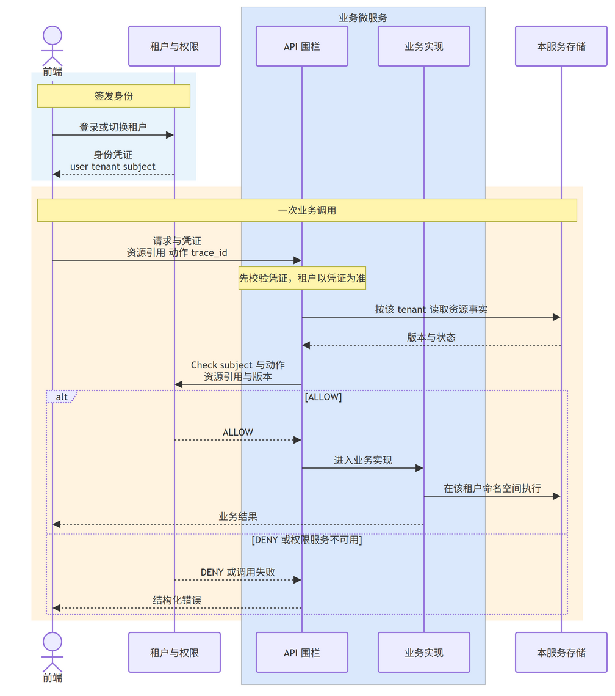
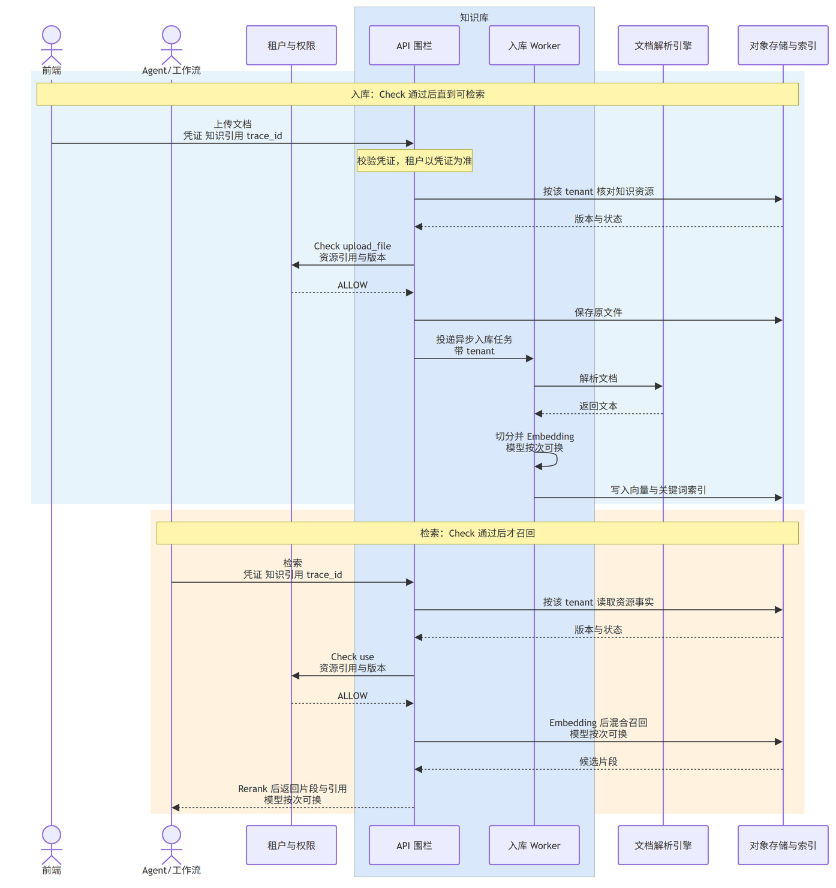

# Platform 微服务设计与开发约定

本文是 Bisheng 平台后续微服务设计和开发的基准。用户通过 Frontend 这一个入口使用平台能力，各领域服务独立开发、部署和扩展。

结构图和时序图放在 `Bisheng-platform/` 下。各服务的时序图按服务分目录。Agent 与工作流编排的详细开发说明和时序图暂缓，接入时仍遵守本文的依赖方向、围栏和隔离规则。

## 1. 总体结构

平台分为四个后端领域。Frontend 是统一用户入口，页面调用各领域服务的 API。

依赖方向如下。从上到下的三条箭头都是身份凭证和 Check。水平箭头指向被调用的服务：Agent 调用知识库，工作流调用助手，工作流也可以直接调用知识库。知识库不依赖 Agent，Agent 不依赖工作流。

知识库提供目录、入库、检索和引用。Agent 定义和运行助手。工作流编排已发布的助手，也可以直接使用知识库。

现有代码的迁移基线如下。服务名称可以调整，领域职责和依赖方向保持不变。

| 现有项目                          | 领域                |
| ----------------------------- | ----------------- |
| `frontend`                    | 统一平台入口和各领域前端模块    |
| 租户与权限（从现有身份、组织、OpenFGA 授权中拆出） | 租户与权限             |
| `knowledge-backend`           | 知识库               |
| `agent-backend`               | Agent（含当前工作台相关能力） |
| `agent-orch-backend`          | 工作流编排             |

## 2. 领域职责

| 领域       | 主要职责                                      | 说明深度       |
| -------- | ----------------------------------------- | ---------- |
| 租户与权限    | 租户、用户、组织、角色、身份凭证、资源授权目录与 Grant、Check、授权审计 | 见第 3 节和时序图 |
| 知识库      | 知识空间、文档上传、解析、切分、索引、检索、引用；API 围栏           | 见第 5 节和时序图 |
| Agent    | 助手定义、模型与 Prompt、工具绑定、助手版本、会话和助手运行         | 详细说明暂缓     |
| 工作流编排    | 流程构建、节点、版本、发布、运行引擎、任务和运行记录                | 详细说明暂缓     |
| Frontend | 统一登录后的页面、导航和交互；只通过各服务 API 使用后端能力          | 见第 7 节     |

## 3. 租户与权限

租户与权限是独立微服务。它签发身份，并作为唯一的授权判定方。业务资源是否存在、版本和状态是否有效，由各业务服务在自己的数据里确认。

### 3.1 身份上下文

- 维护租户、用户、用户与租户的关系，提供登录和切换租户。
- 签发并校验身份凭证。凭证包含 `user`、`tenant`、`subject`，不包含某项资源动作是否允许。
- 维护组织、部门和用户组，作为授权主体。
- 维护菜单和平台入口角色。入口角色只决定能否看到功能入口，不能代替资源动作的 Check。

### 3.2 资源授权

- 维护授权目录。每个业务服务登记自己的资源类型和动作，目录集中放在本服务。
- 保存 Grant：租户、资源类型、资源引用、权限模型、被授权主体。主体可以是用户、部门或用户组。
- 提供 Check，以及授予和撤销。业务服务提交主体、动作、资源引用和版本；本服务返回 ALLOW 或 DENY。
- 本服务不可用时，依赖 Check 的调用按拒绝处理，由业务围栏返回结构化错误。
- 记录授权变更和 Check 的审计。

本服务不保存文件、助手、流程等业务主数据，也不代替业务服务判断资源是否仍存在。

### 3.3 时序

一次调用分两段：先签发只含身份的凭证；业务请求进入该服务自己的 API 围栏，围栏核对本地资源事实后，再向租户与权限发起 Check。ALLOW 才进入业务实现。

## 4. 业务服务的 API 围栏

每个业务微服务在自己的 API 前实现围栏，再进入该 API 的真实逻辑。围栏做三件事：

1. 校验凭证有效，并且只采用凭证中的 `tenant`。请求体里自行携带的租户号不参与隔离。
2. 在本服务自己的库中核对资源仍存在，且租户、版本和状态有效。
3. 向租户与权限服务发起 Check。ALLOW 后进入业务实现；DENY 或租户与权限不可用时返回结构化错误，业务实现不执行。

各业务服务不另建租户表、Grant 表或授权账本。租户隔离使用本服务业务表上的 `tenant_id`，以及本服务自己的库、缓存命名空间和 Bucket。发布时做过的校验不能代替这次运行时 Check。

## 5. 知识库

知识库遵守第 4 节的围栏，再执行本领域的入库和检索。

- 入库动作是 `upload_file`。ALLOW 之后，围栏保存原文件，并向独立 Worker 投递带 `tenant` 的异步任务。Worker 调用文档解析引擎，在服务内完成切分和 Embedding，再把向量与关键词索引导入本服务的对象存储和索引。解析引擎是外部依赖，图中不区分具体供应商。Embedding 与 Rerank 属于知识库，调用时可以按请求切换模型。
- 检索动作是 `use`。ALLOW 之后才做混合召回，并返回 Rerank 后的片段与引用。
- DENY 和租户与权限不可用时的处理与第 3 节相同，知识库时序图只画出放行之后的流水线。

Agent 或工作流使用知识时，只保存知识资源引用和版本，通过知识库 API 完成目录查询、检索和引用解析。权限判定仍由知识库围栏在运行时向租户与权限发起，调用方不自行做出允许结论。

## 6. Agent 与工作流编排

这两类服务的详细开发说明和时序图暂缓。在补充之前，实现必须满足：

- 依赖方向保持第 1 节：二者都依赖租户与权限；Agent 可调用知识库；工作流可调用 Agent 和知识库；不反向依赖。
- 各自实现第 4 节的 API 围栏，并向租户与权限登记自己的资源类型和动作。
- 工作流调用助手时保存 `assistant_id` 和明确的助手版本，只依赖 Agent 的公开运行契约。
- 使用知识时保存知识资源引用和版本，不复制知识库的文件、切片或索引。
- 跨服务请求携带身份凭证、`trace_id`；代表最终用户执行时同时携带 `end_user`。

## 7. 协作、隔离与 Frontend

服务之间通过版本化 HTTP/API 或事件协作。不跨库查询，不共享业务 ORM，不导入对方领域代码。需要关联时只保存稳定资源引用和版本，不把对方业务数据复制成本地影子主表。

每个领域服务拥有独立代码、数据库 Schema、迁移、API、Worker 和发布流程。可以共用 MySQL、Redis、MinIO 等基础设施集群，但必须使用独立数据库和账号、独立 Redis 命名空间、独立 Bucket。API、Worker、定时任务和迁移使用同一服务版本发布。长任务不得依赖 API 进程内状态。

一个下游服务不可用时，不得阻断与它无关的功能。依赖该服务的功能返回结构化错误，或执行已约定的降级。其中，租户与权限不可用时，需要 Check 的操作拒绝执行。

Frontend 对用户呈现为一个整体，负责统一登录、导航、页面组合和 API 调用。它可以聚合不同服务的页面，但不得直接访问任何服务的数据库、Redis、对象存储或内部 Worker。Frontend 只传递身份凭证和调用上下文，不保存跨服务业务状态，也不用菜单隐藏或路由限制代替授权。

## 8. 新服务接入检查

新增或拆分服务前，至少明确：

- 所属领域和数据所有者；
- 对外 API、调用方和依赖方向；
- 向租户与权限登记的资源类型和动作；
- API 围栏如何校验凭证、读取本服务资源事实并发起 Check；
- 数据库、队列、Bucket 和 Worker 的隔离配置；
- 依赖故障时的错误或降级行为；
- Frontend 的路由、入口角色和 API 接入方式；
- 时序图放置于 `Bisheng-platform/<服务目录>/`。

